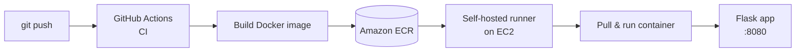

# Wine Quality Prediction: end-to-end ML with AWS CI/CD

An end-to-end machine learning project, from raw data to a containerised web app that is **deployed to AWS automatically on every push**.

- **The model:** predicts red-wine quality from 11 physicochemical measurements.
- **The engineering:** a modular, config-driven pipeline; a Flask web app; Docker; and a GitHub Actions workflow that ships to **Amazon ECR + EC2**.

---

## Architecture



## Training pipeline

`main.py` runs five stages in order. Each stage is a component configured from YAML, and each logs its start and finish.

| # | Stage | What it does |
|---|---|---|
| 1 | Data ingestion | Downloads the dataset archive and unzips it into `artifacts/` |
| 2 | Data validation | Checks every column and dtype against `schema.yaml` and writes a status file |
| 3 | Data transformation | Splits the data into train and test sets |
| 4 | Model training | Trains an **ElasticNet** regressor (hyper-parameters in `params.yaml`) and saves it with joblib |
| 5 | Model evaluation | Scores the test set (**RMSE, MAE, R²**) and saves `metrics.json` |

## Web app

A Flask app (`app.py`) serves:

| Route | Purpose |
|---|---|
| `GET /` | Input form for the 11 wine measurements |
| `POST /predict` | Runs the saved model and shows the predicted quality |
| `GET /train` | Re-runs the full training pipeline |

## CI/CD on AWS

The workflow in `.github/workflows/cicd.yaml` has three jobs:

1. **Continuous Integration** runs on every push to `main`. Its lint and unit-test steps are placeholders for now.
2. **Continuous Delivery** builds the Docker image, logs in to Amazon ECR and pushes the image.
3. **Continuous Deployment** runs on a **self-hosted runner on EC2**: it pulls the latest image from ECR and runs the container on port 8080.

AWS credentials live only in GitHub Actions secrets, never in the code. The deploy user is an IAM user with just the EC2 and ECR permissions it needs.

## Project structure

```
config/config.yaml        # paths for every stage
params.yaml               # model hyper-parameters
schema.yaml               # expected columns, dtypes and target
src/WineQuality/
  components/             # ingestion, validation, transformation, trainer, evaluation
  config/configuration.py # builds typed config objects from YAML
  entity/config_entity.py # dataclasses for each stage's config
  pipeline/               # stage_01 … stage_05, plus prediction.py
  utils/common.py         # YAML/JSON helpers
research/                 # notebooks used to prototype each stage
templates/, static/       # web UI
app.py                    # Flask app
main.py                   # runs the training pipeline
DockerFile                # container image
```

## Run locally

```bash
conda create -n wine python=3.8 -y
conda activate wine
pip install -r requirements.txt

python main.py      # train: runs all 5 stages
python app.py       # serve: http://localhost:8080
```

## Deploy your own copy

1. Create an IAM user with EC2 and ECR access, and an ECR repository.
2. Launch an Ubuntu EC2 instance, install Docker, and register it as a GitHub self-hosted runner (*Settings → Actions → Runners*).
3. Add these repository secrets: `AWS_ACCESS_KEY_ID`, `AWS_SECRET_ACCESS_KEY`, `AWS_REGION`, `AWS_ECR_LOGIN_URI`, `ECR_REPOSITORY_NAME`.
4. Push to `main`, and the workflow builds, pushes and deploys.

## Tech stack

Python · pandas · scikit-learn · Flask · Docker · GitHub Actions · Amazon ECR · Amazon EC2 · IAM

---

**Syed Sohaib Ali Shah** · [Portfolio](https://sohaibashah.vercel.app) · [LinkedIn](https://www.linkedin.com/in/sohaibashah/)
